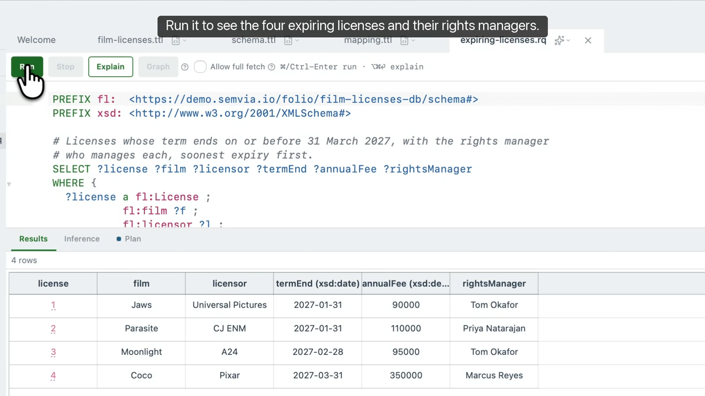

# Folio

**Build a digital twin of your organization, without the platform.**

Folio is a desktop workspace where subject matter experts and their agents
model a domain together, bind it to the databases, APIs, data lakes and
spreadsheets that already hold the data, and query it across sources. No
server, no graph database, no pipeline.

_Watch the 84-second demo: Claude Code connects Folio to a Postgres database of
film licenses, creates a domain model, maps the tables onto it, and queries for
the licenses that expire by March 2027._

## Why Folio

- **Experts and agents build it together.** The expert knows what a customer
  actually means. The agent proposes classes, mappings and fixes, and the
  expert reviews every change. Any agent that supports the Model Context
  Protocol (MCP) can connect.
- **Query across sources without copying data.** SPARQL runs through your
  domain model over Postgres, Snowflake, Databricks, BigQuery and more, web
  APIs, and CSV, Parquet and Excel files.
- **Checked as you write.** Folio validates against your domain model in real
  time, so a mistake shows up the moment you or your agent makes it.
- **Open standards in plain files.** RDF, RDFS, SHACL, SKOS and RML, in text
  files you can diff, review and keep in git. Share your work as versioned
  semantic packages that other teams install.

## Get started

1. **[Download Folio](https://semvia.io/download)** for macOS (Apple Silicon),
   Windows 10 or later (x64) or Linux (x86_64 AppImage). It keeps itself up to
   date.
2. Open any folder as a workspace.
3. **[Connect your agent](https://semvia.io/docs/quickstart/connect-your-agent)**
   and ask it to model one process you know well.

**[Read the docs →](https://semvia.io/docs)**

Folio is in public beta. Keep backups of your workspace and hold off on
production use.

## Pricing

Folio is free for individuals, for companies under $10M in both annual revenue
and funding raised, and for nonprofits and governments under a $10M annual
operating budget. Larger organizations get a 30-day evaluation, then a
[commercial license](https://semvia.io/#contact).

## Feedback

Found a bug or want a feature?
**[Open an issue →](https://github.com/SemviaIO/Folio/issues/new/choose)** or
use the in-app link in Folio. Come talk to us on
**[Discord](https://discord.gg/rfTfQg3zx)**.

---

Built by [Semvia](https://semvia.io).
